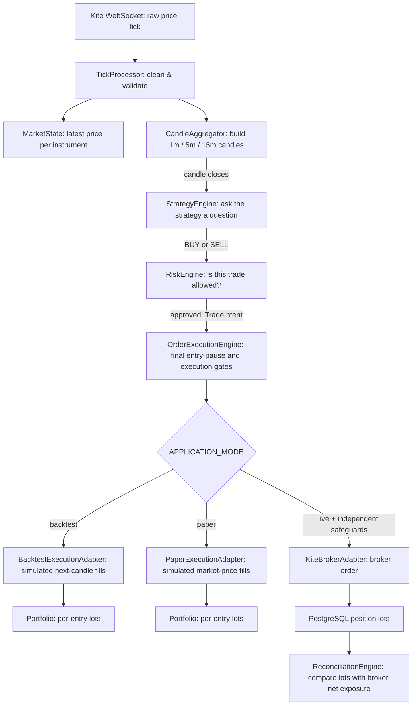

# Flow & Worked Examples

> **New to this project? Start here.** This page explains, in plain
> language, what happens when the application runs, how a tick turns
> into a trade, and walks through four realistic scenarios with concrete
> numbers. The [Architecture page](architecture.md) and the
> [Module Reference](module-reference.md) go deeper into *why* each piece
> exists; this page focuses on *what actually happens, in order*.

## 1. The big picture

At the highest level, each trading process follows this sequence:

1. **Load configuration** -- read bootstrap/local settings and only the
   agreed credential/infrastructure allow-list from AWS Secrets Manager.
   Watchlists, risk, and scoring settings remain database-managed.
2. **Refresh instrument data** -- fetch NSE and NFO from Kite and upsert
   both into PostgreSQL by instrument token. The algorithm process starts
   the selected workflow only after required synchronization.
3. **Load trading settings and select instruments** -- use token IDs from
   database watchlists and resolve their names/metadata from the refreshed
   instrument master.
4. **Watch and analyze the market** -- receive ticks for the signal
   instrument and build candles for the configured strategy/timeframes.
5. **Check controls, risk, and trade** -- the shared order-entry pause is
   checked before signal evaluation and again at the execution boundary.
   Approved entries proceed to simulated fills in backtest/paper or separately
   gated broker submission in live mode. Protective exits bypass the pause;
   manual exits require an in-process runtime and are unavailable from the
   detached dashboard.
6. **Shut down cleanly** -- on `Ctrl+C` or a termination signal, stop
   subscriptions, persist session state, and close resources.

`APPLICATION_MODE=paper` is the default. Start `python -m dashboard.main`
for the dashboard and `python -m trading_system.main` separately for the
database-selected workflow. Both use the shared PostgreSQL configuration.
The detached dashboard does not submit orders or perform manual exits.
Live order execution remains separately gated; selecting live mode alone
never authorizes real orders.

### Signal source and traded instrument

Watchlists identify the **signal source**, using synchronized underlying
EQ/index instrument tokens:

- **Options watchlist:** strategy evaluates the selected underlying EQ or
  index candles; a BUY/SELL decision selects and trades the corresponding
  CE/PE contract. The contract's own market price, lot size, stop, and
  target are used for option risk and order calculations. Saving the
  watchlist requires synchronized CE and PE contracts for a common
  eligible expiry; a call and put from different expiries do not satisfy
  this validation.
- **Equity watchlist:** strategy evaluates the selected tradable cash EQ
  and orders that same EQ. Risk levels derive from that equity's price.

The dashboard displays instrument labels for people, but PostgreSQL stores
the underlying token IDs. AWS Secrets Manager does not override these
database-managed watchlists or score settings.

The dashboard's **Pause new entries** control applies to configured backtest,
paper, and live execution. It does not liquidate positions or block exits.
Operators can select one or more open paper/live position lots for a manual
exit; each exit is audited with reason `MANUAL_EXIT`. Backtest results are
historical and cannot be manually exited.

## 2. The trading pipeline, stage by stage

This is the path a single price update takes, from the exchange to a
(possible) order, and back out again as a position:

In plain words, stage by stage:

| # | Stage | What it does, in one sentence | Where in the code |
| - | ----- | ------------------------------ | ------------------ |
| 1 | Receive | The WebSocket client receives a raw tick from Kite. | `broker/websocket.py::KiteWebSocketClient` |
| 2 | Clean | Obviously broken data (negative price, impossible candle shape) is thrown away before it can corrupt anything downstream. | `market_data/tick_processor.py::TickProcessor` |
| 3 | Remember | The latest price of every instrument is kept in memory and in Redis, so any other part of the app can ask "what's the current price?". | `market_data/tick_processor.py::MarketState` |
| 4 | Build candles | Ticks are grouped into fixed time buckets (e.g. every 5 minutes) to form OHLC candles. | `market_data/candle_aggregator.py::CandleAggregator` |
| 5 | Ask the strategy | The moment a candle closes, the configured strategy looks at recent candles and indicators and decides: buy, sell, or do nothing. | `strategy/strategy_engine.py::StrategyEngine` |
| 6 | Pick the option contract | If the strategy trades options, the underlying's BUY/SELL view is translated into a specific CE/PE contract (e.g. "buy the at-the-money call"). | `strategy/option_selector.py::OptionSelector` |
| 7 | Check the risk | Every proposed trade is checked against configured limits and duplicate rules before anything is sized. Same-signal repeats are deduplicated; distinct index CE/PE signals may add separate lots, while an open EQ position blocks another EQ entry. | `risk/risk_engine.py::RiskEngine` |
| 8 | Size the trade | If approved, the exact quantity (in whole lots) is calculated from your risk budget and the stop-loss distance. | `risk/position_sizer.py::PositionSizer` |
| 9 | Send the order | The execution engine rechecks the shared entry pause; mode-specific adapters simulate fills in backtest/paper, while live submission requires independent safeguards. | `execution/order_execution_engine.py::OrderExecutionEngine` |
| 10 | Track the position | Backtest/paper portfolios retain one lot per entry; live PostgreSQL lots retain entry linkage and individual protective levels. | `backtest/portfolio.py::Portfolio`, `execution/live_trading_runtime.py::LiveTradingRuntime` |
| 11 | Double-check later | Reconciliation compares persisted live lots with the broker's net per-instrument exposure and flags unsafe mismatches for manual action. | `reconciliation/position_reconciler.py::PositionReconciler` |

A few rules hold true at every single stage above, and are worth
remembering before reading the worked examples:

- **Nothing skips a stage.** A signal can't become an order without
  passing through the risk engine first; there is no shortcut path.
- **"No" is always a valid answer**, at every stage. Most candles produce
  no signal; most signals that *are* produced are expected to pass risk
  checks, but a rejection is a normal, logged outcome, not an error.
- **Paper mode is the default.** A paper session still requires explicit
  strategy/instrument selection; live order submission additionally
  requires its separate execution gate.

## 3. Worked example: a trade that goes through

Everything below uses made-up, round numbers to keep the arithmetic easy
to follow -- it's an illustration of the *logic*, not a transcript of a
real run.

**Setup:** select the synchronized NIFTY 50 EQ instrument in the options
watchlist (token `256265` in the sample instrument master), a 5-minute strategy, ATM call/put
buying only, `RISK_MAX_RISK_PER_TRADE=4000` (rupees), ATR-based stop-loss
with a 1.5x multiplier, 1.5x reward:risk target, NIFTY lot size 75.

1. **A candle closes.** At 10:05 AM, the 5-minute NIFTY index candle
   completes: open 22,110, high 22,160, low 22,100, close 22,150.
2. **The strategy fires.** Suppose the configured strategy spots a
   bullish engulfing candle plus RSI crossing up through 55 -- enough
   combined weight to cross its BUY threshold. It returns a `BUY`
   decision at price 22,150.
3. **An option contract is chosen.** Since NIFTY is in the options
   watchlist, `OptionSelector` picks the at-the-money call for the
   nearest expiry: say `NIFTY-25DEC-22150-CE`, currently trading at
   ₹142.50. The signal's price becomes ₹142.50 (the option's own price,
   never the index's).
4. **The signal is validated and saved** as `RISK_CHECK_PENDING` --
   instrument exists, market data is fresh, price is positive: all pass.
5. **The risk engine runs its checklist:**
   - Market data fresh? **Yes.**
   - Inside the allowed trading window, and not within the first/last 15
     minutes of the session? **Yes** (it's 10:05, market opened at 09:15).
   - Already a NIFTY options position open? **No** -- clear to proceed.
   - Same signal already processed, or still in cooldown? **No.**
   - Daily loss limit / daily trade count / max open positions /
     exposure room? **All within limits.**
   - **Stop-loss**: 14-period ATR on the option's own candles comes out
     to ₹18; distance = 18 × 1.5 = **₹27**, so stop-loss = 142.50 − 27 =
     **₹115.50**.
   - **Target**: 1.5× the stop-loss distance = 1.5 × 27 = ₹40.50, so
     target = 142.50 + 40.50 = **₹183.00**.
   - **Position size**: budget ₹4,000 ÷ ₹27 risk-per-unit ≈ 148 units,
     floored to the nearest whole lot of 75 → **75 units (1 lot)**.
   - **Capital required**: 75 × 142.50 = **₹10,687.50**.
   - Every check passed → **`RiskDecision: APPROVED`**, and a
     `TradeIntent` is saved with quantity 75, stop-loss 115.50, target
     183.00.
6. **The order is submitted.** In paper mode, `PaperExecutionAdapter`
   simulates an instant fill at ₹142.50 -- no real money moves, nothing
   reaches Kite. In live mode (only if `ORDER_EXECUTION_ENABLED=true`,
   `APP_ENV=production`, and `APPLICATION_MODE=live` are *all* set), the same
   `TradeIntent` would instead go to `KiteBrokerAdapter`, which places a
   real market order and records the broker's order ID.
7. **The position opens.** The configured runtime records an entry-linked
   lot: 75 units of `NIFTY-25DEC-22150-CE`, entry ₹142.50. Distinct,
   separately deduplicated index signals may create additional lots in the
   same contract; each lot retains its own stop, target, and exit identity.
8. **What happens next?** The live runtime monitors ticks for this
   broker-confirmed position and submits a protective exit through the
   Phase 9 execution gate when its stop-loss or target is reached. On a
   disconnected/stale tick feed it cannot react until market data resumes.
   In paper/backtest mode the corresponding simulated position is checked
   against the traded instrument's candle prices; no real order is placed.

To stop new entries, an operator can pause them in the dashboard without
closing this position. A paper/live operator can then choose this lot and
submit a manual exit; its persisted intent records `MANUAL_EXIT`. Selecting
multiple lots creates individually auditable exits.

## 4. Worked example: a trade that gets rejected

Same candle, same BUY decision from the strategy -- but suppose the
account has already lost ₹4,500 today against a configured
`RISK_MAX_DAILY_LOSS=4000`.

1. Steps 1-4 are identical to the example above: a `BUY` decision is
   produced, a CE contract is chosen, and a `Signal` is saved.
2. The risk engine runs the same checklist, in the same order. Market
   data, trading window, duplicate-position, and cooldown checks all
   still pass.
3. **The daily-loss check fails**: realized loss so far today (₹4,500)
   already exceeds the ₹4,000 limit.
4. The engine stops right there. It does **not** continue on to compute
   a stop-loss or position size for a trade it's about to reject.
5. A `RiskDecision` is still saved -- with `status=REJECTED` and
   `reason=MAX_DAILY_LOSS_EXCEEDED` -- so there's a permanent, auditable
   record of *why* no trade happened.
6. **No `TradeIntent` is created, no order is sent, nothing is submitted
   to the broker.** The pipeline simply stops one stage early. This is
   the normal, everyday outcome for most signals once any single risk
   limit is configured -- not a bug and not a crash.

## 5. Worked example: reconciliation catching a mismatch

Reconciliation runs independently of the pipeline above -- it compares
what PostgreSQL/Redis *believe* against what the broker actually reports,
and only ever flags or safely corrects differences; it never places an
order itself.

**Scenario A -- a fill that was missed locally (safe to auto-correct):**
the application submitted an order and recorded it as `SUBMITTED`
(acknowledged, not yet confirmed filled), but a brief network hiccup
meant the fill confirmation was never received. The next reconciliation
run calls `Broker.get_orders()` and sees this exact order is actually
`COMPLETE` with all 75 units filled at ₹142.75. Because "broker says
filled, local says submitted" is on the pre-approved safe list
(`RECONCILIATION_AUTO_SYNC_ORDER_STATUS=true`), the local order row is
updated to `FILLED` automatically, and the change is written to the
audit trail (`order_reconciliation_records`).

**Scenario B -- an unexplained broker position (never auto-corrected):**
the broker reports a 150-unit position in an instrument PostgreSQL has no
record of at all. This is exactly the kind of mismatch the system refuses
to guess about: it's recorded as `BROKER_ONLY` with status
`REQUIRES_MANUAL_ACTION`, and reconciliation stops there for that
instrument. It is never auto-attributed to a strategy, never closed, and
never treated as a new trade to manage -- a human has to look at it.

**The rule that separates A from B:** a *decrease* or an *exact match* in
quantity, or a known order reaching a further-along status, is
considered safe to sync automatically. Any *increase* in quantity, a
sign flip (long vs. short), or a position/order the local database has
never heard of at all, always requires a human to look at it -- see
[Phase 10](phases/phase-10-reconciliation.md) for the complete rule set.

## 6. Worked example: running a backtest

Configure `APPLICATION_MODE=backtest`, strategy, watchlist, instrument
mode, dates, interval, and initial capital in the dashboard, then start
`python -m trading_system.main`. The historical run executes once in the
background while the dashboard remains available.

What happens when this runs:

1. A brand-new, empty SQLite database and an in-memory Redis are created
   just for this one run -- completely separate from your real
   PostgreSQL/Redis, so a backtest can never affect real data.
2. Historical candles for both underlying instruments between the two
   dates are loaded (from PostgreSQL if already synced, otherwise from
   Kite's historical-data API), then replayed in timestamp order.
3. The *exact same* `StrategyEngine` → `RiskEngine` →
   `OrderExecutionEngine` pipeline described in section 2 runs candle by
   candle, in order, exactly as it would live -- except every "send the
   order" step goes to a simulated adapter instead of Kite, and a
   signal can only ever fill using a *later* candle's price (never the
   candle that generated it, which would be cheating).
4. The replay checks the shared order-entry pause as well as the execution
boundary; pausing skips new entries but leaves simulated protective exits
active. The two instruments share one virtual portfolio and starting capital.
   At the end of the run, a single `BacktestResult` is produced: for example,
   *42 trades, 58% win rate, profit factor 1.7, max drawdown 6.2%* --
   and a summary row is saved to the real database's `backtest_runs` /
   `backtest_trades` tables so past runs can be compared later.
5. Nothing here ever reaches the real Kite API, and no real order is ever
   placed -- see [Phase 11](phases/phase-11-backtesting-paper.md) for the
   full list of simulation assumptions (slippage, fill rules, costs).

## 7. Where to go next

- Want the *why* behind each design choice above? Read
  [Architecture & Data Flow](architecture.md).
- Want the full list of every file and what it's responsible for? Read
  [Module Reference](module-reference.md).
- Want to actually run this? Read [Setup & Configuration](setup.md) and
  [Operations](operations.md).
- Want to know exactly what's missing before this can trade for real?
  Read [Safety Mechanisms & Roadmap](safety-and-limitations.md).
