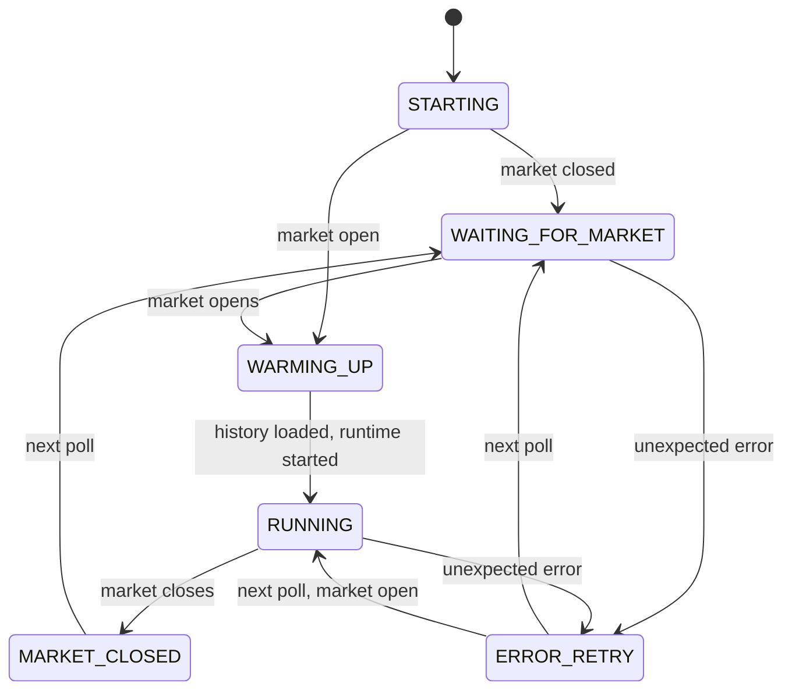
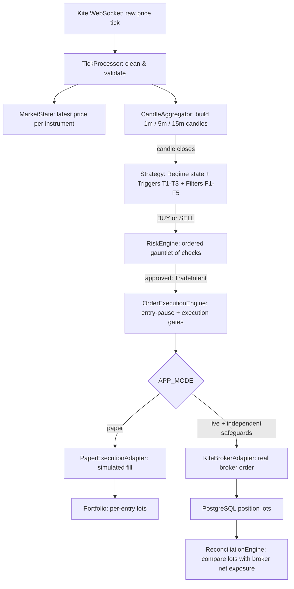
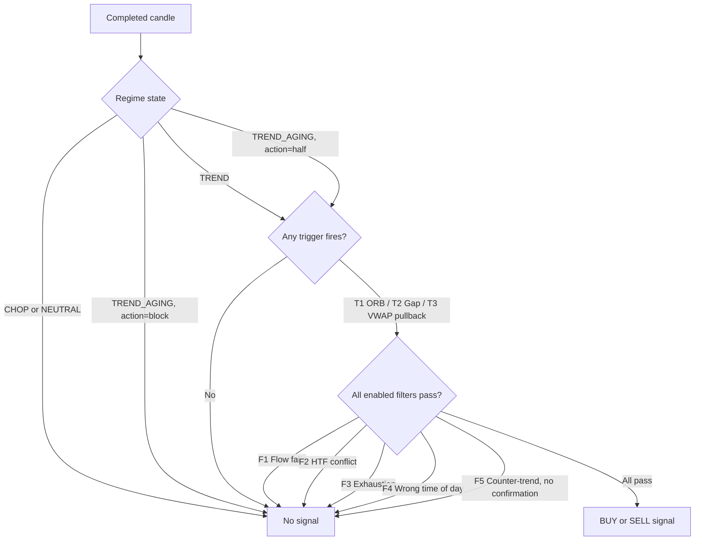
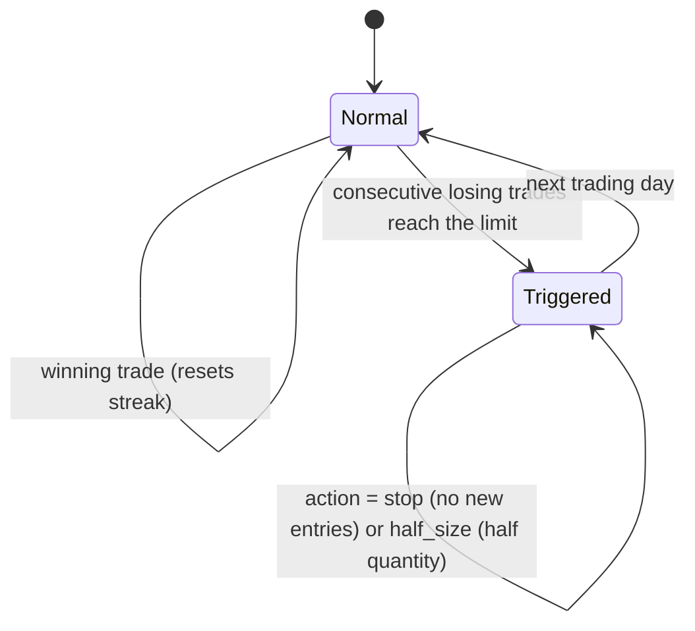
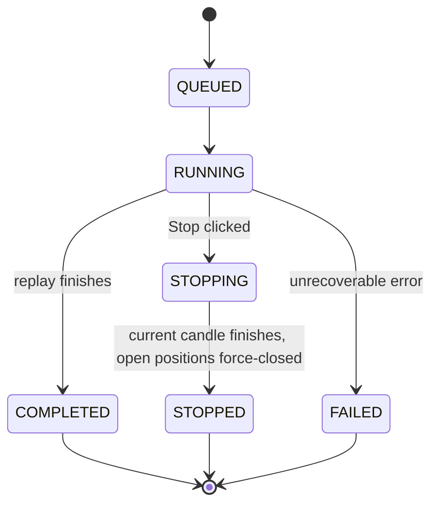

# Flow, Strategy Logic & Diagrams

> **New to this project? Start here.** This page explains, in plain
> language, what happens when the application runs, how the built-in
> strategy decides to buy or sell, how a signal turns into (or is
> refused) a trade, and walks through concrete worked examples. The
> [Architecture page](architecture.md) and the
> [Module Reference](module-reference.md) go deeper into *why* each piece
> exists; this page focuses on *what actually happens, in order*, with
> diagrams.

## 1. The process never exits because the market is closed

The process has exactly two startup modes — `APP_MODE=paper` or `APP_MODE=live` (there is no
longer a "backtest" startup mode; backtests are an on-demand job you
trigger from the dashboard against a *running* paper/live process — see
section 6). Whichever mode you start in, the app runs a small state
machine for the rest of its life and never shuts itself down just because
NSE is closed:



Starting the app on a Sunday (or any time outside 09:15-15:30 IST, or on
an NSE holiday) logs a single line explaining why the market is closed and
when it next opens, then the process sits in `WAITING_FOR_MARKET` — the
dashboard and its API stay fully available the whole time. A background
supervisor thread polls every `MARKET_SUPERVISOR_POLL_SECONDS` (default
15s) and logs a heartbeat every `HEARTBEAT_INTERVAL_SECONDS` (default
1800s) while waiting, so you can tell the process is alive without the
logs being spammed. The moment the market opens, it warms up (loads the
historical candles the slowest indicator needs) and starts evaluating on
the next fully-completed candle — never a partially-formed one. At close,
it stops the paper/live runtime and goes back to waiting for the next
session. Check the live state at any time with:

```
GET /api/status
```

which returns `mode`, `state`, `market_open`, `next_open`,
`reason_closed`, and `last_error` — see [How-To](how-to.md) for a worked
example of reading this.

## 2. The trading pipeline, stage by stage

This is the path a single completed candle takes, from the market data
layer to a (possible) order, and back out again as a position:



A few rules hold true at every stage:

- **Nothing skips a stage.** A signal can't become an order without
  passing through the risk engine first.
- **"No" is always a valid answer**, at every stage. Most candles produce
  no signal; most signals that *are* produced are expected to pass risk
  checks, but a rejection is a normal, logged outcome, not an error.
- **A signal only ever uses bars completed before it fired.** No rule,
  trigger, filter, or indicator is allowed to look at the candle it's
  about to fill on — it fills at the *next* bar's open (or later, under a
  conditional entry mode — see section 5).

## 3. How the strategy decides to trade

There is no weighted score anywhere in this path — **a trigger firing is
a boolean fact, not a point contribution.** The strategy is a
regime-gated trigger system, evaluated fresh on every completed candle:



**Regime** is one of four states, recomputed every candle from ADX,
choppiness index, directional efficiency, and an ATR percentile:

- **TREND** — ADX is rising and above its minimum, choppiness is low,
  directional efficiency and ATR percentile both clear their floors.
  Entries are allowed.
- **TREND_AGING** — still technically a TREND, but showing age: the day's
  running price extreme in the trade direction is old (default >60
  minutes), or price has crossed VWAP too many times today (default ≥2),
  or ADX has dropped meaningfully off its peak-so-far. Depending on the
  configured `aging_action`, entries here are either **blocked** or
  allowed at **half size**.
- **CHOP** — high choppiness and weak ADX together. No entries.
- **NEUTRAL** — none of the above conditions are clearly met (or data is
  insufficient). No entries, same as CHOP.

**Triggers** (an entry needs at least one to fire):

- **T1 — Opening-range breakout.** A close beyond the first N minutes'
  high/low (default 15 minutes).
- **T2 — Gap resolution.** After a significant overnight gap, either a
  close beyond the prior running extreme (continuation) or a confirmed
  fade back through the open — never a blind entry on the gap bar itself.
- **T3 — VWAP pullback.** Price pulls back to session VWAP or EMA21 and
  resumes with a close in the trend direction, confirmed by open-interest
  buildup in that same direction.

**Filters** (every enabled one must pass):

- **F1 — Flow.** Long OI buildup for a BUY / short OI buildup for a SELL,
  or volume at least 1.5x its 20-bar average.
- **F2 — Higher-timeframe confirmation.** The 60-minute EMA9/21 must not
  conflict with the trade direction (the daily value is still computed
  and logged, but no longer vetoes by default).
- **F3 — Exhaustion.** Blocks an entry too far (in ATR terms) from VWAP/
  EMA9, or on an abnormally wide signal bar.
- **F4 — Time of day.** All triggers are allowed 09:30-11:15 IST; from
  12:00-14:00 only a fresh extreme or a T1/T2 trigger qualifies; nothing
  new after 14:15.
- **F5 — Counter-trend flip.** The first trade against the day's
  established direction needs two consecutive closes beyond VWAP *and*
  EMA21 plus a retest, and trades at half size — it's deliberately harder
  to reverse than to continue.

Every regime state, trigger result, and filter result is independently
toggleable from the dashboard's settings page (**Regime, Triggers &
Filters** group) so you can A/B test variants without touching code.

## 4. The risk engine: an ordered gauntlet, not a single check

Every approved signal must pass every one of these checks, in this exact
order — the first failure stops the pipeline right there and is recorded
as a `RiskDecision` with the reason, whether or not a trade happens:

```mermaid
flowchart LR
    A[Signal] --> B[Validation] --> C[Market data fresh?] --> D[Trading window?]
    D --> E[Existing position / idea clustering?] --> F[Duplicate signal?]
    F --> G[Cooldown?] --> H[Daily loss limit?] --> I[Daily trade count?]
    I --> J[Daily circuit breaker?] --> K[Idea risk budget?] --> L[Total open-risk cap?]
    L --> M[Max open positions?] --> N[Exposure room?] --> O[Stop-loss/target calc]
    O --> P[Min risk:reward?] --> Q[Position sizing] --> R[Quantity valid?]
    R --> S[TradeIntent: APPROVED]
```



Notable checks in that pipeline:

- **Idea clustering** — entries within a configurable window (default 20
  minutes) on the same underlying + direction count as one "idea"; by
  default only one entry per idea is allowed (the old unlimited-pyramiding
  behavior is still available behind a flag).
- **Daily circuit breaker** (see diagram below).
- **Idea risk budget** — the total risk (entry-to-stop distance ×
  quantity) across every entry in one idea cluster may not exceed
  `RISK_MAX_RISK_PER_TRADE` — the same absolute rupee limit already used
  to size a single trade, reused here as the cluster-wide budget so
  there's one number to edit, not a separate percent-of-capital setting.
- **Total open-risk cap** — total risk summed across every currently-open
  position, account-wide, has its own percent-of-capital ceiling
  (`RISK_TOTAL_OPEN_RISK_CAP_PERCENT`), in addition to the per-trade limit
  above.

### The daily circuit breaker



Only trades that have **already exited** count toward the streak — an
open position never counts, and the streak resets every trading day (and,
by default, on any winning trade). When the configured limit of
consecutive losing trades is reached, new entries are either blocked for
the rest of the day (`action=stop`) or sized at half quantity
(`action=half_size`, falling back to a full block if that would round to
less than one lot). Every activation is logged and visible per-signal in
the dashboard's risk-decisions table.

> The specific "stopped a third put on Nov 2" / "blocked two entries on
> Nov 16" scenario that motivated this feature comes from the project
> owner's own earlier manual trading history — it's a real, useful
> illustration of *why* the feature exists, but it is not a number this
> codebase's test suite reproduces (there's no historical market data for
> those exact dates baked into this repository). The mechanism itself is
> covered by synthetic, repeatable tests instead.

## 5. Worked example: running a backtest from the dashboard

Open **Backtests** in the dashboard, enter the admin token, pick a start
and end date (presets: last 5 days / last 30 days / current month — the
page shows an approximate trading-day count and rejects future dates or a
reversed range), and click **Run Backtest**.



What happens underneath:

1. A `PENDING` run row is saved, then a background task marks it `RUNNING`.
   A brand-new, empty SQLite database and an in-memory Redis are created
   just for this one run — completely isolated from your real PostgreSQL/
   Redis, and it runs independently of whether the market is open or the
   paper/live runtime is active.
2. Historical candles are loaded and replayed in timestamp order through
   the *exact same* strategy → risk → execution pipeline described above,
   using a simulated clock. A signal can only ever fill using a *later*
   candle's price, never the one that generated it.
3. While it runs, the dashboard polls a progress endpoint showing a
   status chip, a progress bar, the current candle's timestamp, and
   elapsed time.
4. Clicking **Stop** requests a smooth stop: the engine finishes whatever
   candle it's on, force-closes any open simulated positions at that
   candle's close (`exit_reason=BACKTEST_STOPPED`), and persists a
   `STOPPED` result — not a crash, not a `FAILED` run. A stopped run's
   results and export work exactly like a completed one.
5. Results auto-load when the run finishes or stops. **Export** downloads
   an XLSX (or CSV zip) with: Run Info, Run Summary (+ exit-reason
   breakdown), Config Snapshot (the exact settings that run used, frozen
   at trigger time), Candle Log (one row per processed candle, including
   every no-signal/blocked candle), Signals & Risk Audit, Trades, Equity
   Curve, Daily Summary, Rejected and Blocked, Data Quality, and Run Log.
   Only one backtest runs at a time; a second request while one is active
   gets a clear "already running" response.

Every number in every sheet, every log line, and every API response is
rounded to exactly 2 decimal places at the point it's displayed/exported
— this is purely an output-formatting rule (`trading_system.utils.
formatting.round2`/`format2`); nothing about it changes what a signal
would have done, since all of the actual decision math runs at full
precision internally.

## 6. Worked example: a trade that gets rejected

Same candle, same BUY decision from the strategy — but suppose the
account has already lost ₹4,500 today against a configured
`RISK_MAX_DAILY_LOSS=4000`.

1. A `BUY` decision is produced and a CE contract is chosen, same as a
   normal entry.
2. The risk engine runs its checklist in order. Market data, trading
   window, duplicate-position, idea-clustering, duplicate-signal, and
   cooldown checks all still pass.
3. **The daily-loss check fails**: realized loss so far today (₹4,500)
   already exceeds the ₹4,000 limit.
4. The engine stops right there — it never computes a stop-loss or
   position size for a trade it's about to reject.
5. A `RiskDecision` is still saved with `status=REJECTED` and
   `reason=MAX_DAILY_LOSS_EXCEEDED`, so there's a permanent, auditable
   record of *why* no trade happened.
6. **No `TradeIntent` is created, no order is sent.** This is the normal,
   everyday outcome once any risk limit is configured — not a bug.

## 7. Worked example: reconciliation catching a mismatch

Reconciliation runs independently of the pipeline above — it compares
what PostgreSQL/Redis *believe* against what the broker actually reports,
and only ever flags or safely corrects differences; it never places an
order itself.

**A fill that was missed locally (safe to auto-correct):** the
application submitted an order and recorded it as `SUBMITTED`, but a
network hiccup meant the fill confirmation never arrived. The next
reconciliation run sees the broker already reports it `COMPLETE`, and
because "broker says filled, local says submitted" is on the pre-approved
safe list, the local order row is updated automatically and the change is
written to the audit trail.

**An unexplained broker position (never auto-corrected):** the broker
reports a position PostgreSQL has no record of at all. This is recorded
as `BROKER_ONLY`/`REQUIRES_MANUAL_ACTION` and reconciliation stops there
for that instrument — it is never guessed at, auto-attributed, or closed.
A human has to look at it.

## 8. Where to go next

- Want to actually run something? Read the [How-To Guide](how-to.md).
- Have a quick question? Check the [FAQ](faq.md).
- Want the *why* behind each design choice above? Read
  [Architecture & Data Flow](architecture.md).
- Want the full list of every file and what it's responsible for? Read
  [Module Reference](module-reference.md).
- Want to know exactly what's missing before this can trade for real?
  Read [Safety Mechanisms & Roadmap](safety-and-limitations.md).
